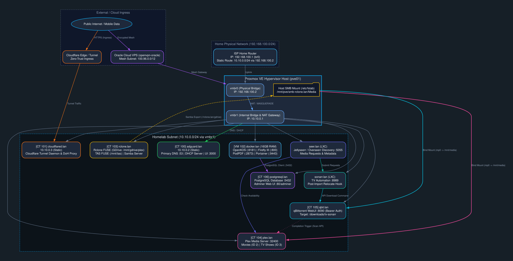

# Homelab Infrastructure Map

This document serves as the high-level architecture overview and network topology map for the homelab environment hosted on Proxmox VE.

---

## Visual Architecture & Network Topology

  

---

## Node Details & Responsibilities

### 1. `pve01` (Proxmox VE Host) 
- **Role:** Bare-metal hypervisor host running Proxmox VE.
- **Network Interfaces:**
  - `vmbr0`: Bridged exclusively to the physical Home ISP Router (`192.168.100.2/24`).
  - `vmbr1`: Isolated internal bridge serving the `10.10.0.0/24` homelab subnet (`10.10.0.1` gateway).
- **Storage Integration:** SMB mounts are managed directly at the host level.
- **Key Files:**
  - `/etc/fstab` — Handles mount points on boot, mounting `//rclone.lan/gdrive` at `/mnt/pve/smb-rclone.lan/Media`.

---

### 2. `adguard.lan` (CT 100) 
- **Role:** Primary local DNS server, DHCP daemon, and ad-blocking gateway.
- **IP:** `10.10.0.2` (Static / `adguard.home.server`)
- **Services & Ports:**
  - DNS Server: Port `53` (TCP/UDP)
  - Web UI: Port `3000` (HTTP)
  - DHCP Server for `10.10.0.0/24` subnet.

---

### 3. `cloudflared.lan` (CT 101) 
- **Role:** Cloudflare Zero-Trust Tunnel gateway connected directly to Cloudflare Edge / Mesh (`100.96.0.0/12`), providing secure external ingress without opening inbound ports on the ISP router.
- **IP:** `10.10.0.3` (Static)
- **Features:** Forwards DNS-over-HTTPS (DoH) and tunnel traffic to the `10.10.0.0/24` subnet.

---

### 4. `rclone.lan` (CT 103) 
- **Role:** Manages cloud storage synchronization and mounting (Google Drive & Telegram as Storage - TAS) and triggers automated library scanning when files change.
- **Systemd Services:**
  - `/etc/systemd/system/plex-watcher.service` — Daemon process managing automatic starts and stops for the watcher script.
  - `/etc/systemd/system/rclone-gdrive.service` — Daemon process for mounting the `gdrive` remote from rclone.
  - `/etc/systemd/system/tas-mount.service` — Daemon process for mounting Telegram as Storage (TAS) locally.
  - `/etc/systemd/system/tas-sync.service` — Daemon process managing automated synchronization jobs for TAS.
- **Mount Points:**
  - `/mnt/gdrive/plex` — Google Drive rclone mount.
  - `/mnt/tas` — Telegram as Storage (TAS) FUSE mount point.
- **Network Share:**
  - Samba server exporting `//rclone.lan/gdrive` to `pve01`.

---

### 5. `plex.lan` (CT 104) 
- **Role:** Media server running Plex Media Server.
- **Port:** `32400`
- **Storage Path:** `/mnt/media` (LXC bind mount from `pve01`'s `/mnt/pve/smb-rclone.lan/Media`).
- **Plex Section IDs:**
  - **Movies:** Section ID `2`
  - **TV Shows:** Section ID `3`

---

### 6. `sonarr.lan` (LXC Container) 
- **Role:** Smart TV episode automation daemon. Tracks, grabs, and manages library importing for TV shows.
- **Port:** `8989`
- **Mounts / Paths:**
  - `/mnt/media/TV` — Directory for the final local TV library.
- **Integrations & Hooks:**
  - **Download Client:** Connects to `qbit.lan:8090` using a native Bearer Token API Key.
  - **Custom Post-Import Script:** Executes `/root/scripts/qbit-relocate.sh` on download/import events to rename/relocate files in qBittorrent, cleanup local source duplicates, and resume seeding.
- **Key Settings:**
  - `Create Empty Series Folders` enabled to generate root show directories immediately on add.

---

### 7. `seer.lan` (LXC Container) 
- **Role:** Media request and discovery platform (Jellyseerr / Overseerr).
- **Port:** `5055`
- **Integrations:**
  - **Sonarr Connection:** Connects to `sonarr.lan` to push TV requests into Sonarr's queue.
  - **Radarr Connection:** Connects to `radarr.lan` (CT 109) to push movie requests into Radarr's queue.
  - **Plex Connection:** Scrapes `plex.lan` to verify media availability.

---

### 8. `qbit.lan` (CT 105) 
- **Documentation:** [`containers/ct105-qbit.md`](containers/ct105-qbit.md)
- **Role:** Torrent downloader handling television and movie file transfers.
- **Port:** `8090`
- **Storage:**
  - Bind mount: `/mnt/media`
  - Save path: `/downloads/tv-sonarr` — Designated target path for television files.
- **Key Configurations:**
  - **WebAPI v2.14+ API Key Auth:** Generates bearer tokens for passwordless external scripts.
  - **Path Mapping:** Remote path mappings translate `/downloads/tv-sonarr` to Sonarr's internal access path.
  - **Torrent Completion Hook:** Executes `/root/.config/qBittorrent/discord_qbit_notification.sh` to trigger direct Plex library scans (Movies ID 2, TV ID 3) and send rich Discord notifications for non-Arr downloads.

---

### 9. `docker.lan` (VM 102) 
- **Role:** Dedicated Docker VM with 16GB RAM.
- **Hosted Projects:**
  - **OpenKOS** (Uses CT 106 PostgreSQL)
  - **Firefly III** (Uses CT 106 PostgreSQL)
  - **PodPDF**
  - **Steam-ish**
  - **Portainer**

---

### 10. `postgresql.lan` (CT 106) 
- **Role:** Dedicated shared database server running PostgreSQL and Adminer.
- **Default Port:** `5432`
- **Adminer Port:** `80` (access at `http://postgresql.lan/adminer`)
- **Hosted Databases:**
  - `openkos` — Primary database for the OpenKOS platform.
  - `firefly` — Primary database for the Firefly III Budgeting App.

---

### 11. `radarr.lan` (CT 109) 
- **Role:** Smart movie automation and collection manager.
- **Port:** `7878`
- **Mounts / Paths:**
  - `/mnt/media/Movies` (LXC bind mount from host SMB)
- **Integrations:**
  - Connects to `qbit.lan:8090` to grab movie releases.
  - Syncs with `prowlarr.lan` (CT 110) for indexers.
  - Triggers Plex Section 2 (Movies) on import.

---

### 12. `prowlarr.lan` (CT 110) 
- **Role:** Centralized indexer proxy and manager for all Arr services.
- **Port:** `9696`
- **Integrations:**
  - Automatically synchronizes Usenet and Torrent indexers with Sonarr and Radarr (CT 109).

---

### 13. `bazarr.lan` (CT 111) 
- **Role:** Companion subtitle automation daemon for TV shows and movies.
- **Port:** `6767`
- **Mounts / Paths:**
  - `/mnt/media/TV` and `/mnt/media/Movies`
- **Integrations:**
  - Integrates with Sonarr and Radarr (CT 109) to automatically fetch matching subtitles.

---

### 14. `openvpn-oracle` (Oracle Cloud VPS) 
- **Role:** Remote cloud node on Oracle Cloud Infrastructure, connected directly through the Cloudflare Edge / Mesh network (`100.96.0.0/12`) to provide secure remote offsite ingress.
