```dot
digraph NetworkTopology {
    // Global graph settings
    graph [
        rankdir = "TB",
        compound = true,
        bgcolor = "#161f27",
        fontname = "Helvetica, Arial, sans-serif",
        fontsize = 12,
        nodesep = 0.5,
        ranksep = 0.6,
        pad = "0.4"
    ];

    // Global node settings
    node [
        shape = box,
        style = "rounded,filled",
        fillcolor = "#1e293b",
        color = "#38bdf8",
        penwidth = 1.5,
        fontname = "Helvetica, Arial, sans-serif",
        fontsize = 11,
        fontcolor = "#f8fafc",
        margin = "0.2,0.15"
    ];

    // Global edge settings
    edge [
        fontname = "Helvetica, Arial, sans-serif",
        fontsize = 9,
        fontcolor = "#94a3b8",
        color = "#64748b",
        penwidth = 1.2,
        arrowsize = 0.8
    ];

    // External / Cloud Cluster
    subgraph cluster_external {
        label = "External / Cloud Ingress";
        fontcolor = "#94a3b8";
        fontsize = 12;
        style = "dashed";
        color = "#475569";
        bgcolor = "#0f172a";

        wan [label = "Public Internet / Mobile Data", shape = ellipse, fillcolor = "#1e293b", color = "#0ea5e9"];
        cf [label = "Cloudflare Edge / Tunnel\nZero-Trust Ingress", fillcolor = "#1e293b", color = "#f97316"];
        vps [label = "Oracle Cloud VPS (openvpn-oracle)\nMesh Subnet: 100.96.0.0/12", fillcolor = "#1e293b", color = "#a855f7"];
    }

    // Physical Network Cluster
    subgraph cluster_physical {
        label = "Home Physical Network (192.168.100.0/24)";
        fontcolor = "#94a3b8";
        fontsize = 12;
        style = "dashed";
        color = "#475569";
        bgcolor = "#0f172a";

        router [label = "ISP Home Router\nIP: 192.168.100.1 (br0)\nStatic Route: 10.10.0.0/24 via 192.168.100.2", fillcolor = "#1e293b", color = "#38bdf8"];
    }

    // Proxmox VE Host Cluster
    subgraph cluster_pve {
        label = "Proxmox VE Hypervisor Host (pve01)";
        fontcolor = "#e2e8f0";
        fontsize = 13;
        style = "filled";
        fillcolor = "#1e293b";
        color = "#0ea5e9";
        penwidth = 2;

        vmbr0 [label = "vmbr0 (Physical Bridge)\nIP: 192.168.100.2", fillcolor = "#334155", color = "#60a5fa"];
        vmbr1 [label = "vmbr1 (Internal Bridge & NAT Gateway)\nIP: 10.10.0.1", fillcolor = "#334155", color = "#60a5fa"];
        host_smb [label = "Host SMB Mount (/etc/fstab)\n/mnt/pve/smb-rclone.lan/Media", shape = folder, fillcolor = "#0f172a", color = "#eab308"];
    }

    // Homelab Internal Subnet Cluster
    subgraph cluster_homelab {
        label = "Homelab Subnet (10.10.0.0/24 via vmbr1)";
        fontcolor = "#e2e8f0";
        fontsize = 13;
        style = "dashed";
        color = "#0284c7";
        bgcolor = "#0c1319";

        ct100 [label = "[CT 100] adguard.lan\n10.10.0.2 (Static)\nPrimary DNS :53 | DHCP Server | UI :3000", fillcolor = "#1e293b", color = "#22c55e"];
        ct101 [label = "[CT 101] cloudflared.lan\n10.10.0.3 (Static)\nCloudflare Tunnel Daemon & DoH Proxy", fillcolor = "#1e293b", color = "#f97316"];
        vm102 [label = "[VM 102] docker.lan (16GB RAM)\nOpenKOS (:8181) | Firefly III (:800)\nPodPDF (:2873) | Portainer (:9443)", fillcolor = "#1e293b", color = "#38bdf8"];
        ct106 [label = "[CT 106] postgresql.lan\nPostgreSQL Database :5432\nAdminer Web UI :80/adminer", fillcolor = "#1e293b", color = "#a855f7"];
        ct103 [label = "[CT 103] rclone.lan\nRclone FUSE (GDrive: /mnt/gdrive/plex)\nTAS FUSE (/mnt/tas) | Samba Server", fillcolor = "#1e293b", color = "#eab308"];
        ct104 [label = "[CT 104] plex.lan\nPlex Media Server :32400\nMovies (ID 2) | TV Shows (ID 3)", fillcolor = "#1e293b", color = "#ec4899"];
        ct105 [label = "[CT 105] qbit.lan\nqBittorrent WebUI :8090 (Bearer Auth)\nTarget: /downloads/tv-sonarr", fillcolor = "#1e293b", color = "#06b6d4"];
        sonarr [label = "sonarr.lan (LXC)\nTV Automation :8989\nPost-Import Relocate Hook", fillcolor = "#1e293b", color = "#14b8a6"];
        seer [label = "seer.lan (LXC)\nJellyseerr / Overseerr Discovery :5055\nMedia Requests & Metadata", fillcolor = "#1e293b", color = "#6366f1"];
    }

    // External Connections
    wan -> cf [label = "HTTPS (Ingress)", color = "#f97316"];
    wan -> vps [label = "Encrypted Mesh", color = "#a855f7"];
    router -> vmbr0 [label = "Uplink"];
    vps -> vmbr0 [label = "Mesh Gateway", color = "#a855f7"];
    cf -> ct101 [label = "Tunnel Traffic", color = "#f97316"];

    // Host Bridges & Routing
    vmbr0 -> vmbr1 [label = "NAT / MASQUERADE", color = "#60a5fa"];
    vmbr1 -> ct100 [label = "DNS / DHCP", color = "#22c55e"];
    vmbr1 -> ct101;
    vmbr1 -> vm102;
    vmbr1 -> ct106;
    vmbr1 -> ct103;
    vmbr1 -> ct104;
    vmbr1 -> ct105;
    vmbr1 -> sonarr;
    vmbr1 -> seer;

    // Storage Pipeline
    ct103 -> host_smb [label = "Samba Export (//rclone.lan/gdrive)", style = "dashed", color = "#eab308"];
    host_smb -> ct104 [label = "Bind Mount (mp0 -> /mnt/media)", color = "#ec4899", penwidth = 1.8];
    host_smb -> ct105 [label = "Bind Mount (mp0 -> /mnt/media)", color = "#06b6d4", penwidth = 1.8];

    // Service Integrations
    vm102 -> ct106 [label = "PostgreSQL Client (:5432)", color = "#a855f7"];
    seer -> sonarr [label = "Submit Requests", color = "#14b8a6"];
    seer -> ct104 [label = "Check Availability", color = "#6366f1"];
    sonarr -> ct105 [label = "API Download Command", color = "#06b6d4"];
    ct105 -> ct104 [label = "Completion Trigger (Scan API)", style = "dotted", color = "#ec4899"];
}
```

# Homelab Infrastructure Map

This document serves as the high-level architecture overview and network topology map for the homelab environment hosted on Proxmox VE.

---

## Visual Architecture & Network Topology

### ASCII Topology Diagram

```text
[ Public Internet / Mobile Data ]
             |
 +-----------+-----------+
 |                       |
 v                       v
[ Home ISP Router ]   [ Cloudflare Edge / Mesh ]
(br0: 192.168.100.1/24) (Mesh 100.96.0.0/12)
Static Route: 10.10.0.0/24
via 192.168.100.2
 +-----------+-----------+
 |                       |
 |                       v
 |             +-------------------------+
 |             | [ openvpn-oracle VPS ]  |
 |             | (Cloud Mesh Node)       |
 |             +------------+------------+
 |                          |
 v                          v
+----------------------------------------+
| Proxmox Host (pve01)                   |
| vmbr0: 192.168.100.2                   |
| vmbr1: 10.10.0.1 (GW)                  |
+-------------------+--------------------+
                    |
====================+======================================== vmbr1
10.10.0.0/24 Subnet | (DHCP & DNS via 10.10.0.2)
====================+========================================
                    |
                    v
+--> [CT 101] cloudflared (10.10.0.3 / cloudflared.lan)
|    |-- Forwards DoH & Tunnel traffic to 10.10.0.0/24
|
+--> [CT 100] adguard (10.10.0.2 / adguard.home.server)
|    |-- Primary DNS (:53), DHCP Server, Web UI (:3000)
|
+--> [VM 102] docker (DHCP / docker.lan) [16GB RAM]
|    |-- OpenKOS Suite -------------------> [Uses CT 106]
|    |   |-- openkos-web-1 (:8181 -> :8080)
|    |   |-- openkos-queue-1 & openkos-scheduler-1
|    |   |-- openkos-redis-1 (:6379)
|    |   +-- openkos-mailpit-1 (:8025 / :1025)
|    |-- Firefly III Suite ---------------> [Uses CT 106]
|    |   |-- firefly_iii_core (:800 -> :8080)
|    |   |-- firefly_iii_importer (:810 -> :8080)
|    |   +-- firefly_iii_cron
|    |-- Privacy-First PDF
|    |   +-- podpdf (:2873 -> :8080)
|    |-- Gaming & Administration
|    |   |-- steam-ish (:3112 -> :3000)
|    |   +-- portainer (:9443 / :8000)
|    +-- System Management
|
+--> [CT 106] postgresql (DHCP / postgresql.lan)
|    +-- Shared PostgreSQL (:5432) & Adminer (:80/adminer)
|
+--> [CT 103] rclone (DHCP / rclone.lan)
|    +-- Rclone FUSE (gdrive:plex) + Samba Server (//rclone.lan/gdrive)
|
+--> [CT 104] plex (DHCP / plex.lan)
|    +-- Bind Mount: /mnt/media <--- Host SMB (/mnt/pve/smb-rclone.lan/Media)
|
+--> [CT 105] qbit (DHCP / qbit.lan)
     +-- Bind Mount: /mnt/media <--- Host SMB (/mnt/pve/smb-rclone.lan/Media)
```

### Graphviz Digraph Network Diagram

<div style="text-align: center; margin: 1.5rem 0;">
  
</div>

<details>
<summary>View Graphviz Digraph Source Code</summary>



</details>

---

## Node Details & Responsibilities

### 1. `pve01` (Proxmox VE Host) 
- **Role:** Bare-metal hypervisor host running Proxmox VE.
- **Network Interfaces:**
  - `vmbr0`: Bridged to physical LAN (`192.168.100.2/24`).
  - `vmbr1`: Isolated internal bridge serving the `10.10.0.0/24` homelab subnet (`10.10.0.1` gateway).
- **Storage Integration:** SMB mounts are managed directly at the host level.
- **Key Files:**
  - `/etc/fstab` — Handles mount points on boot, mounting `//rclone.lan/gdrive` at `/mnt/pve/smb-rclone.lan/Media`.

---

### 2. `adguard.lan` (CT 100) 
- **Role:** Primary local DNS server, DHCP daemon, and ad-blocking gateway.
- **IP:** `10.10.0.2` (Static)
- **Services & Ports:**
  - DNS Server: Port `53` (TCP/UDP)
  - Web UI: Port `3000` (HTTP)
  - DHCP Server for `10.10.0.0/24` subnet.

---

### 3. `cloudflared.lan` (CT 101) 
- **Role:** Cloudflare Zero-Trust Tunnel gateway providing secure external ingress to internal homelab services without opening inbound firewall ports on the ISP router.
- **IP:** `10.10.0.3` (Static)
- **Features:** Forwards DNS-over-HTTPS (DoH) and tunnel traffic to the `10.10.0.0/24` network.

---

### 4. `rclone.lan` (CT 103) 
- **Role:** Manages cloud storage synchronization and mounting (Google Drive & Telegram as Storage - TAS) and triggers automated library scanning when files change.
- **Systemd Services:**
  - `/etc/systemd/system/plex-watcher.service` — Daemon process managing automatic starts and stops for the watcher script.
  - `/etc/systemd/system/rclone-gdrive.service` — Daemon process for mounting the `gdrive` remote from rclone.
  - `/etc/systemd/system/tas-mount.service` — Daemon process for mounting Telegram as Storage (TAS) locally.
  - `/etc/systemd/system/tas-sync.service` — Daemon process managing automated synchronization jobs for TAS.
- **Mount Points:**
  - `/mnt/gdrive/plex` — Google Drive rclone mount.
  - `/mnt/tas` — Telegram as Storage (TAS) FUSE mount point.
- **Network Share:**
  - Samba server exporting `//rclone.lan/gdrive` to `pve01`.

---

### 5. `plex.lan` (CT 104) 
- **Role:** Media server running Plex Media Server.
- **Port:** `32400`
- **Storage Path:** `/mnt/media` (LXC bind mount from `pve01`'s `/mnt/pve/smb-rclone.lan/Media`).
- **Plex Section IDs:**
  - **Movies:** Section ID `2`
  - **TV Shows:** Section ID `3`

---

### 6. `sonarr.lan` (LXC Container) 
- **Role:** Smart TV episode automation daemon. Tracks, grabs, and manages library importing for TV shows.
- **Port:** `8989`
- **Mounts / Paths:**
  - `/mnt/media/TV` — Directory for the final local TV library.
- **Integrations & Hooks:**
  - **Download Client:** Connects to `qbit.lan:8090` using a native Bearer Token API Key.
  - **Custom Post-Import Script:** Executes `/root/scripts/qbit-relocate.sh` on download/import events to rename/relocate files in qBittorrent, cleanup local source duplicates, and resume seeding.
- **Key Settings:**
  - `Create Empty Series Folders` enabled to generate root show directories immediately on add.

---

### 7. `seer.lan` (LXC Container) 
- **Role:** Media request and discovery platform (Jellyseerr / Overseerr).
- **Port:** `5055`
- **Integrations:**
  - **Sonarr Connection:** Connects directly to `sonarr.lan` to push requested television shows into Sonarr's monitoring queue.
  - **Plex Connection:** Scrapes `plex.lan` to check file availability before approving user requests.

---

### 8. `qbit.lan` (CT 105) 
- **Documentation:** [`containers/ct105-qbit.md`](containers/ct105-qbit.md)
- **Role:** Torrent downloader handling television and movie file transfers.
- **Port:** `8090`
- **Storage:**
  - Bind mount: `/mnt/media`
  - Save path: `/downloads/tv-sonarr` — Designated target path for television files.
- **Key Configurations:**
  - **WebAPI v2.14+ API Key Auth:** Generates bearer tokens for passwordless external scripts.
  - **Path Mapping:** Remote path mappings translate `/downloads/tv-sonarr` to Sonarr's internal access path.
  - **Torrent Completion Hook:** Executes `/root/.config/qBittorrent/discord_qbit_notification.sh` to trigger direct Plex library scans (Movies ID 2, TV ID 3) and send rich Discord notifications for non-Arr downloads.

---

### 9. `docker.lan` (VM 102) 
- **Role:** Dedicated Docker VM with 16GB RAM hosting multiple application stacks.
- **Hosted Stacks:**
  - **OpenKOS Suite:** (Uses CT 106 PostgreSQL)
    - `openkos-web-1` (`:8181` -> `:8080`)
    - `openkos-queue-1` & `openkos-scheduler-1`
    - `openkos-redis-1` (`:6379`)
    - `openkos-mailpit-1` (`:8025` / `:1025`)
  - **Firefly III Suite:** (Uses CT 106 PostgreSQL)
    - `firefly_iii_core` (`:800` -> `:8080`)
    - `firefly_iii_importer` (`:810` -> `:8080`)
    - `firefly_iii_cron`
  - **Privacy Tools:**
    - `podpdf` (`:2873` -> `:8080`)
  - **Administration & Gaming:**
    - `steam-ish` (`:3112` -> `:3000`)
    - `portainer` (`:9443` HTTPS / `:8000` HTTP)

---

### 10. `postgresql.lan` (CT 106) 
- **Role:** Dedicated shared database server running PostgreSQL and Adminer.
- **Default Port:** `5432`
- **Adminer Port:** `80` (access at `http://postgresql.lan/adminer`)
- **Hosted Databases:**
  - `openkos` — Primary database for the OpenKOS platform.
  - `firefly` — Primary database for the Firefly III Budgeting App.
- **Standard Administration Commands:**
  - Create new user:
    ```bash
    sudo -u postgres createuser --interactive --pwprompt
    ```
  - Connect to postgres instance:
    ```bash
    psql -h postgresql.lan -U postgres
    ```
  - Assign database ownership:
    ```sql
    ALTER DATABASE db OWNER TO new_user;
    ```
