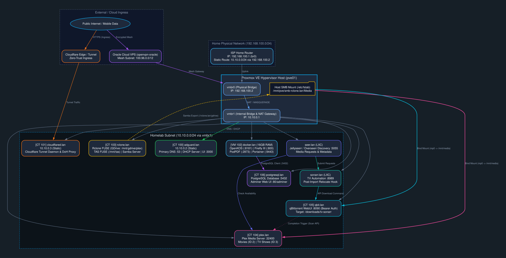

# Network Architecture & Topology 

This document details the IP addressing, routing tables, DNS resolution, DHCP scopes, and ingress mechanisms across the homelab network.

<div style="text-align: center; margin: 1.5rem 0;">
  
</div>

---

## 1. Network Segmentation & Subnets

### Physical / ISP Network
- **Subnet:** `192.168.100.0/24`
- **Router / Gateway:** `192.168.100.1` (`br0`)
- **Proxmox Physical Uplink:** `192.168.100.2` (`vmbr0`)
- **Static Route on ISP Router:**
  ```text
  Destination: 10.10.0.0/24
  Next Hop / Gateway: 192.168.100.2
  ```
  *This static route allows devices on the primary physical home network to reach homelab services directly without double-NAT.*

---

### Homelab Internal Network
- **Subnet:** `10.10.0.0/24`
- **Bridge Interface:** `vmbr1` on `pve01`
- **Gateway:** `10.10.0.1` (`pve01` virtual bridge interface)
- **Primary DNS & DHCP Server:** `10.10.0.2` (`adguard.lan` / CT 100)
- **External Ingress Gateway:** `10.10.0.3` (`cloudflared.lan` / CT 101)

---

### Remote Cloud Mesh & VPS
- **Subnet Range:** `100.96.0.0/12` (Carrier-grade / Tailscale / Cloudflare Mesh)
- **VPS Node:** `openvpn-oracle` (Oracle Cloud Infrastructure)
- **Purpose:** Acts as an offsite mesh node for encrypted ingress and secure remote management when outside the home network.

---

## 2. DNS & DHCP Architecture (`adguard.lan`)

- **Primary DNS Listener:** Port `53` (TCP/UDP) on `10.10.0.2`
- **DHCP Pool:** Handled by AdGuard Home for all dynamically addressed LXCs and VMs on `vmbr1` (`10.10.0.0/24`).
- **Local Domain:** `.lan`
- **DNS Rewrites / Records:**
  - `adguard.lan` -> `10.10.0.2`
  - `cloudflared.lan` -> `10.10.0.3`
  - `docker.lan` -> DHCP reservation
  - `rclone.lan` -> DHCP reservation
  - `plex.lan` -> DHCP reservation
  - `qbit.lan` -> DHCP reservation
  - `postgresql.lan` -> DHCP reservation
  - `sonarr.lan` -> DHCP reservation
  - `seer.lan` -> DHCP reservation

---

## 3. Ingress & Cloudflare Tunnel Architecture (`cloudflared.lan`)

- All public ingress avoids open firewall ports by establishing outbound tunnels from `cloudflared.lan` (CT 101) to the Cloudflare Edge network.
- **DoH Proxy:** Translates internal DNS requests to encrypted DNS-over-HTTPS.
- **Public Services Exposed via Tunnel:**
  - OpenKOS Web (`http://docker.lan:8181`)
  - Firefly III Core (`http://docker.lan:800`)
  - PodPDF (`http://docker.lan:2873`)
  - Jellyseerr (`http://seer.lan:5055`)
- **Restricted / Internal Only Services:**
  - Proxmox Web GUI (`https://192.168.100.2:8006` or `https://10.10.0.1:8006`)
  - Portainer (`https://docker.lan:9443`)
  - AdGuard Admin (`http://adguard.lan:3000`)
  - PostgreSQL / Adminer (`http://postgresql.lan/adminer`)
  - qBittorrent Web UI (`http://qbit.lan:8090`)
